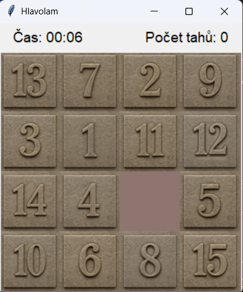

# Sliding Puzzle – Python

A desktop sliding puzzle game developed in Python as a personal project to practice object-oriented programming (OOP), algorithms, and GUI development.

The project revisits a puzzle I originally programmed in Z80 Assembly on the ZX Spectrum when I was 17.

## Features

- Three board sizes: 3×3, 4×4 and 5×5.
- Intuitive mouse controls – click a movable tile to automatically slide all tiles between it and the empty space.
- Automatic movement direction detection and smooth tile animations.
- Random board shuffling using valid moves to guarantee solvability.
- Game timer and move counter.
- SQLite database for storing completed game results.
- Hall of Fame with the top 10 results and rankings by completion time and number of moves.

## Technical implementation

**Python | Tkinter | Pillow | SQLite | OOP**

The application separates game logic from the graphical user interface:

- `Grid` manages the puzzle matrix, valid moves, shuffling and completion checks.
- `PuzzleApp` handles mouse input, animations, the timer and the user interface.
- SQLite stores game results and supports rankings through SQL queries.

The movement algorithm supports sliding multiple tiles in a single move rather than moving only one adjacent tile.

## Running the application

Requires Python 3 and Pillow.

Install Pillow:

pip install Pillow

Run the application:

python main.py

The `Pictures` directory must be present alongside `main.py`.

## About the project

Developed in March 2026 as a practical OOP learning project.

The application was designed and implemented by me, with AI assistance used for mentoring, technical discussions and reviewing implementation decisions.
